# QuantumShield

**AI-Driven Post-Quantum Cryptographic Migration & Quantum Risk Intelligence Platform**

A working research platform that discovers cryptographic assets, assesses
their exposure to future quantum attacks, and plans a post-quantum
migration — built around one non-negotiable rule: **nothing in this
project is allowed to be fabricated.** Every score, every benchmark
number, every quantum result, every screenshot below is produced by real,
re-executable code. Where something is synthetic or simulated, it is
labeled as such everywhere it appears — in the code, the API, and the UI.

`76/76 backend tests passing` · `ruff check: clean` · `13-page live frontend, zero mocked data` · `4/4 ablation study types executed` · `real PostgreSQL verified`

---

## What this is

Modern organizations run enormous amounts of public-key cryptography
(TLS, certificates, key exchange, signatures) with no clean inventory of
where it lives or how exposed it is to the eventual arrival of
cryptographically-relevant quantum computers. QuantumShield is an
end-to-end answer to that problem, built and evaluated like a research
system rather than a demo:

```
discover assets → classify algorithms → assess quantum risk (rule + AI) →
recommend a PQC strategy → benchmark the alternatives → plan the migration →
simulate it → verify → (repeat)
```

Every stage above is real code, covered by tests, and backed by an
experiment that measured it rather than assumed it. See
[`docs/masters-application/01_project_summary.md`](docs/masters-application/01_project_summary.md)
for the full narrative and
[`FINAL_RESEARCH_AUDIT.md`](FINAL_RESEARCH_AUDIT.md) for an unhedged,
line-by-line VERIFIED / NOT-VERIFIED status of every component.

## What's real vs. simulated vs. synthetic (read this first)

| Label | Meaning | Where it applies |
|---|---|---|
| **REAL** | Produced by executing real code against real libraries, right now, on this machine | Every benchmark number, every SHAP explanation, every API response |
| **SYNTHETIC** | Generated data, clearly labeled, never presented as real organizational data | The AI risk model's training set; the 42-asset "enterprise lab" |
| **QUANTUM SIMULATION** | Runs on Qiskit Aer, never real quantum hardware | The Grover/Shor labs — hard-capped at 16 qubits so they are structurally incapable of touching a cryptographically relevant key size |

This project does not, has not, and will not claim to break real
RSA/ECC/AES. See [`docs/security/threat-model.md`](docs/security/threat-model.md)
and [`docs/masters-application/02_quantum_motivation.md`](docs/masters-application/02_quantum_motivation.md).

---

## See it working

Screenshots below are real, captured via headless Chromium against a live
backend with live, populated data (42 assets, 126 risk assessments, 126
recommendations, real benchmark and quantum-lab runs) — not mockups.

<table>
<tr>
<td width="50%">

**Executive Overview** — real inventory/risk/migration stats, live from the database
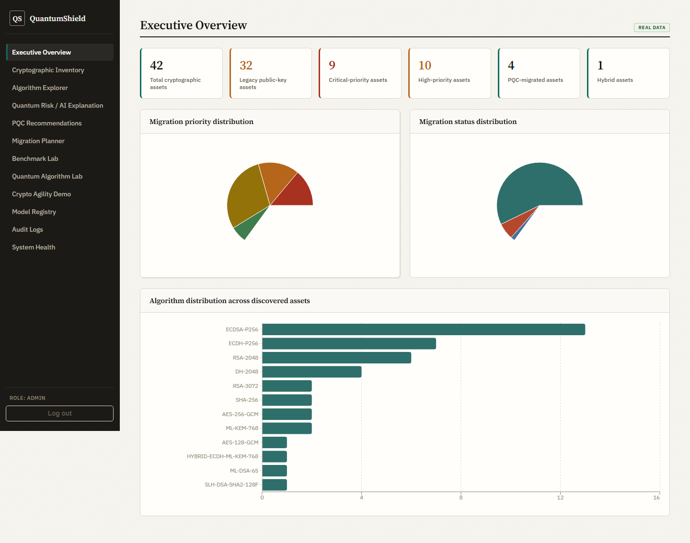
</td>
<td width="50%">

**Cryptographic Inventory** — all 42 discovered assets, real algorithm/risk/status data
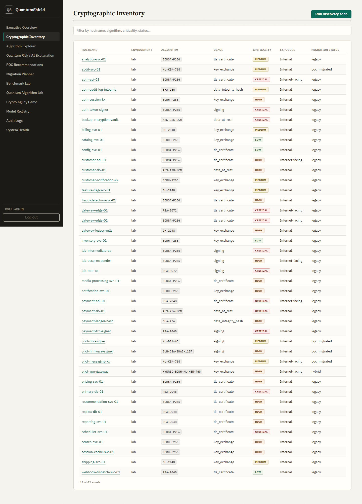
</td>
</tr>
<tr>
<td width="50%">

**Quantum Risk / AI Explanation** — SHAP-explained risk scores, labeled SYNTHETIC where the training data is synthetic
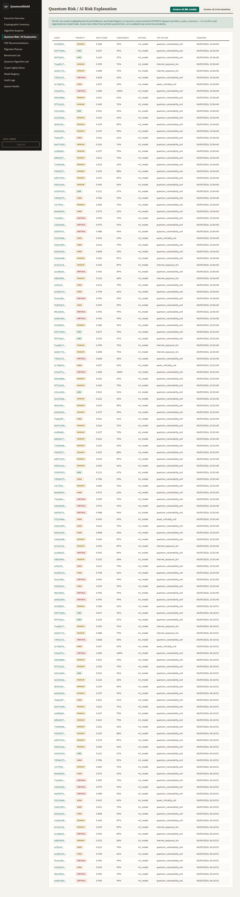
</td>
<td width="50%">

**Asset Detail** — per-asset config, real risk factors, PQC recommendation
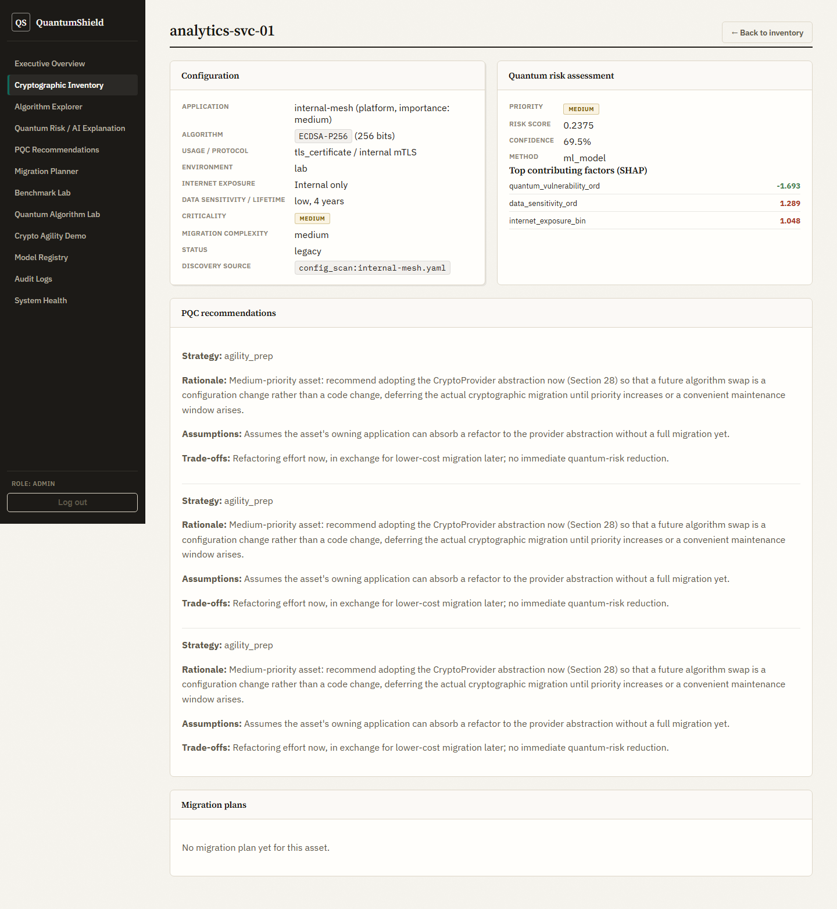
</td>
</tr>
<tr>
<td width="50%">

**PQC Recommendations** — transparent, deterministic rationale/assumptions/trade-offs, surfaced verbatim

</td>
<td width="50%">

**Migration Plan Detail** — real effort formula, real benchmark-derived performance deltas, verification criteria
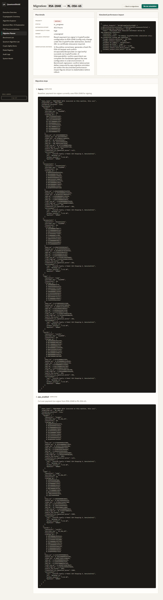
</td>
</tr>
<tr>
<td width="50%">

**Benchmark Lab** — real timing/CI chart, and a "Run" button that triggers a real benchmark
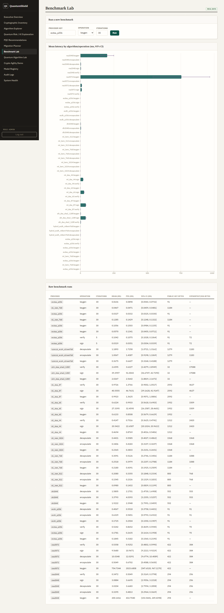
</td>
<td width="50%">

**Quantum Algorithm Lab** — a real, live Grover run (96.53% success probability), with a prominent SIMULATOR badge
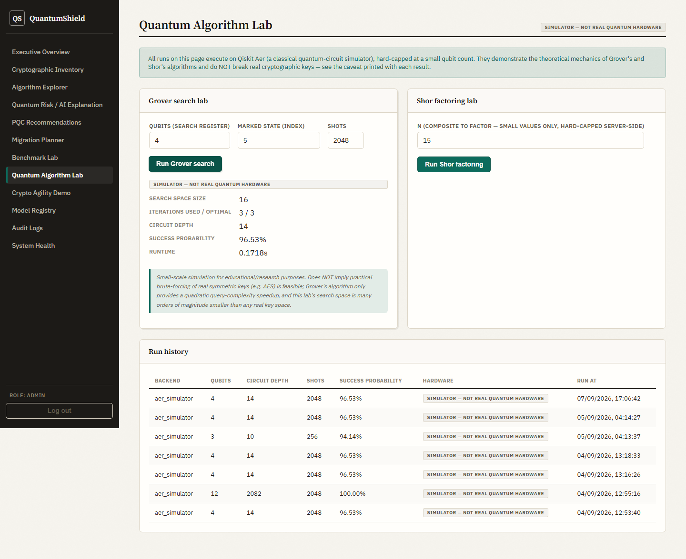
</td>
</tr>
</table>

<details>
<summary><b>More screenshots</b> — Algorithm Explorer, Migration Planner, Crypto Agility Demo, Model Registry, Audit Logs, Login</summary>

| | |
|---|---|
| 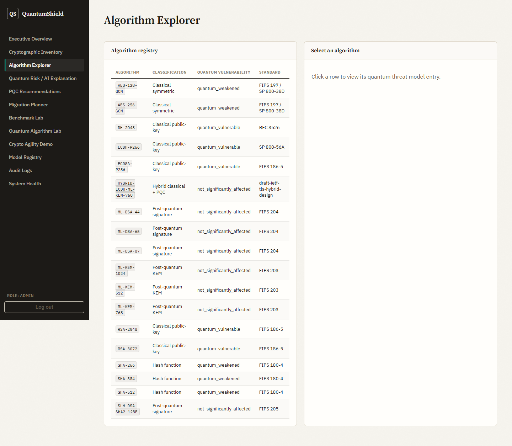 Algorithm Explorer — full registry + quantum threat model | 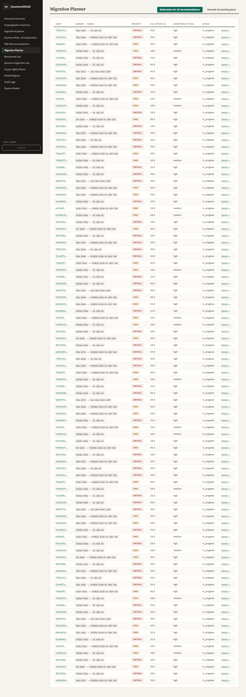 Migration Planner — real effort/priority/status per plan |
| 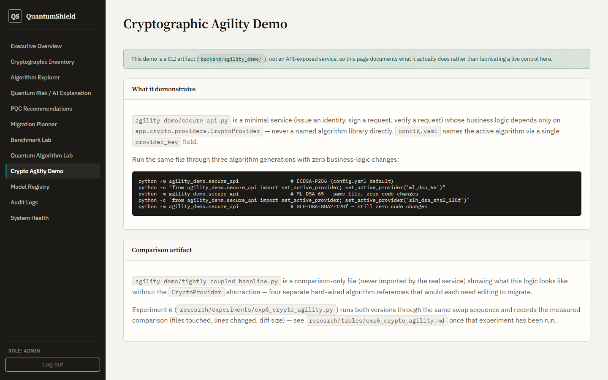 Crypto Agility Demo — documents the real zero-code-change swap | 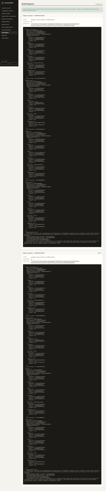 Model Registry — real trained-model metrics, never hand-typed |
| 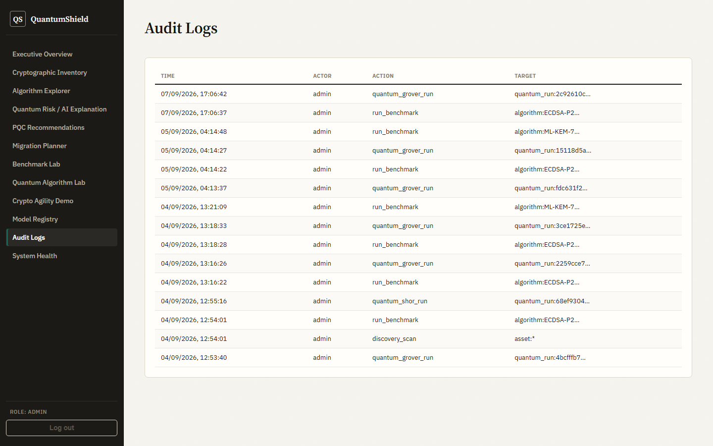 Audit Logs — every state-changing action, real actor/target/timestamp | 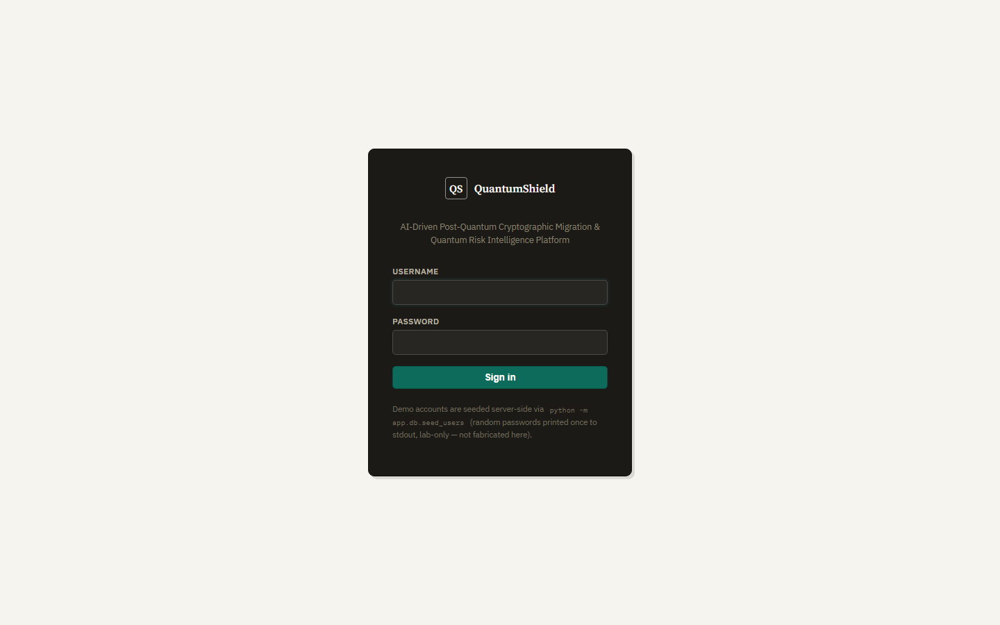 Login — real JWT auth, role-aware UI |

</details>

---

## Real results (not projected, not assumed)

### PQC vs. classical: measured, not asserted
30 iterations × 13 algorithms/compositions, real timing + real artifact sizes ([full table](research/tables/benchmark_comparison.md) via `make benchmark`):

| Finding | Evidence |
|---|---|
| PQC keygen is often **faster** than RSA | ML-KEM-512: 0.098ms vs. RSA-2048: 200ms (~2,000x) |
| PQC signatures are sometimes **much larger** | SLH-DSA-SHA2-128F: 17,088 bytes vs. ECDSA-P256: 70 bytes (~244x) |
| Hybrid costs both components | ECDH+ML-KEM-768 encapsulate: 1.01ms vs. ML-KEM-768 alone: 0.25ms |

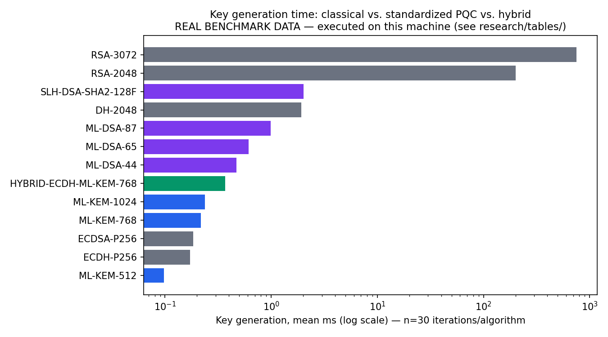

### AI risk model vs. rule baseline: a real, sometimes counter-intuitive comparison
Trained on a documented **SYNTHETIC** dataset with a deliberately withheld
nonlinear interaction term ([`app/ai/dataset.py`](backend/app/ai/dataset.py)), evaluated with **paired bootstrap + permutation
significance testing**, not just point estimates:

| Model | Macro-F1 | vs. rule baseline, statistically significant? |
|---|---|---|
| Rule baseline (deterministic) | 0.7232 | — |
| **Logistic regression** | **0.7897** | **yes** (p = 0.0005) |
| Random forest | 0.7709 | no (p = 0.057, borderline) |
| XGBoost | 0.7349 | **no** (p = 0.659) |

The simplest model won, and it is statistically significant. XGBoost's
apparent edge over a hand-written rule turned out to be indistinguishable
from noise — reported exactly as found, not adjusted. Full writeup:
[`docs/masters-application/09_ai_risk_experiments.md`](docs/masters-application/09_ai_risk_experiments.md).

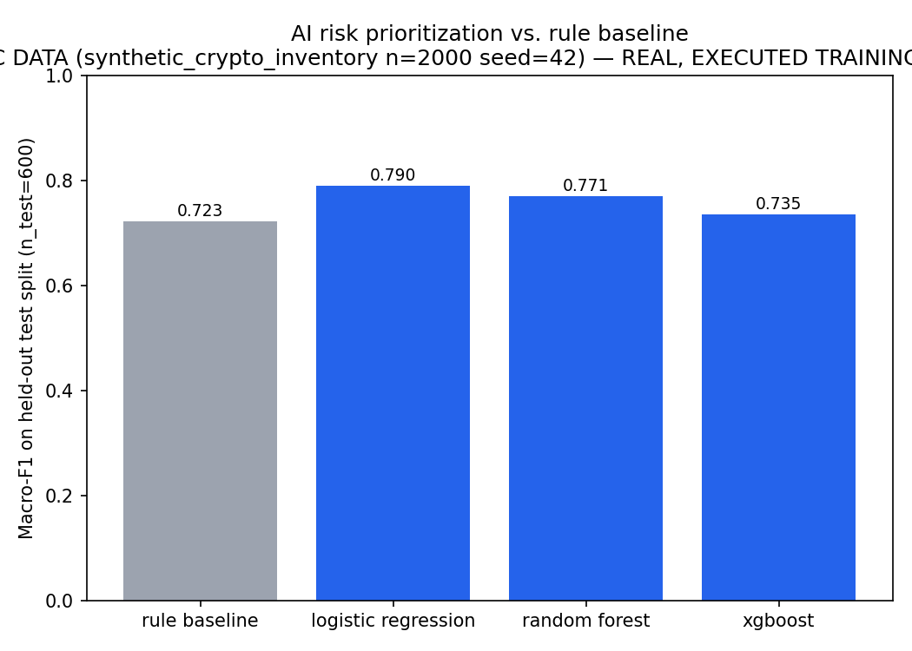

### Cryptographic agility: measured, not claimed
Swapping the sample service's signing algorithm through
`ECDSA-P256 → ML-DSA-65 → SLH-DSA-SHA2-128F` produced **zero changed lines**
in its business-logic file at every step — verified by SHA-256 hash
equality, not asserted — with a real sign/verify roundtrip succeeding each
time. A tightly-coupled comparison version needs 4 separate edits for the
same swap. ([`research/experiments/exp6_crypto_agility.py`](research/experiments/exp6_crypto_agility.py))

### Quantum noise sensitivity: a concrete illustration, not hand-waving
The same 4-qubit Grover search, ideal simulator vs. a modest
(0.1–2% per-gate/readout) noise model:

| Backend | Success probability | Circuit depth |
|---|---|---|
| Ideal (`AerSimulator`, no noise) | 96.14% | 14 |
| Noisy (depolarizing + readout error) | 43.87% | 171 |
| Real quantum hardware | **NOT RUN** — no hardware integration exists |

A ~52 percentage-point collapse from realistic-but-modest gate error rates
— a real, measured illustration of why current NISQ-era hardware is far
short of what Shor's algorithm needs at cryptographic scale.

### A real bug PostgreSQL caught that SQLite silently missed
Running the full demo pipeline against a real `docker-compose` PostgreSQL
instance (not just SQLite) surfaced `StringDataRightTruncation`: a
`VARCHAR(32)` column with real config values up to 50 characters, silently
accepted by SQLite (which doesn't enforce VARCHAR limits) for the whole
prior development history. Fixed via a proper Alembic migration; a
dedicated CI job now runs the full pipeline against real Postgres on every
push. See [`docs/masters-application/13_failures_and_lessons.md`](docs/masters-application/13_failures_and_lessons.md)
for this and every other failure this project hit and fixed rather than hid.

---

## Architecture

```
Enterprise/Lab Environment (synthetic, 8 services, 42 assets)
        │
        ▼
Cryptographic Asset Discovery ──► Inventory (~20-entity relational schema)
        │
        ▼
Algorithm Classification (AlgorithmRegistry) + Quantum Threat Model
        │
        ▼
AI Quantum Risk Engine ◄──────────► Rule-based baseline (compared, not assumed inferior)
   (LogReg/RF/XGBoost + SHAP)
        │
        ▼
PQC Recommendation Engine (deterministic, explainable, now benchmark-aware)
        │
        ▼
Crypto Benchmark Engine ──► Migration Planner ──► Migration Simulator
        │
        ▼
FastAPI (JWT + RBAC + audit log) ──► React/TypeScript dashboard
```

Cryptographic agility is structural, not aspirational: business logic
depends only on a `CryptoProvider` interface
([`ADR-001`](docs/architecture/adr/ADR-001-crypto-provider-abstraction.md)) —
never on `cryptography` or `pqcrypto` directly — implemented for Classical
(RSA/ECDSA/ECDH/DH), PQC (ML-KEM-512/768/1024, ML-DSA-44/65/87,
SLH-DSA-SHA2-128f), and Hybrid (ECDH+ML-KEM-768) providers.

## Tech stack

**Backend:** Python 3.12, FastAPI, SQLAlchemy 2 + Alembic, PostgreSQL/SQLite,
`cryptography` + `pqcrypto` (PQClean), Qiskit + Qiskit Aer, scikit-learn +
XGBoost + SHAP, Prometheus client, pytest, ruff.
**Frontend:** React 19, TypeScript, Vite, React Router, Recharts.
**Infra:** Docker Compose (Postgres, backend, frontend/nginx, Prometheus,
Grafana), GitHub Actions CI (lint, 76-test suite, dependency audit, a
dedicated real-PostgreSQL integration job).

## Quickstart

```
make setup      # venv + backend deps + frontend deps
make test        # 76-case backend test suite
make demo         # discover -> classify -> assess -> recommend -> plan -> simulate
make api            # FastAPI dev server (localhost:8000)
make frontend         # Vite dev server (localhost:5173), proxies to the API
```

Seed demo login accounts (random passwords printed once, lab-only):
```
cd backend && ../.venv/Scripts/python -m app.db.seed_users
```

### Run the full stack with Docker Compose

```
cp .env.example .env
# edit .env and set QS_SECRET_KEY to a real generated secret - the backend
# refuses to start without one (see app/core/config.py)
docker compose up --build
```

Brings up PostgreSQL, the backend (migrations applied automatically on
container start, non-root user, `/api/v1/health`-based `HEALTHCHECK`),
the frontend on `:5173`, and Prometheus/Grafana for observability.

Regenerate every research artifact from real, re-executed code:
```
make research                 # figures/tables from `make benchmark` + `make train` output
make exp6                      # crypto-agility measurement (Experiment 6)
make ablation                   # AI risk feature ablation
make ai-model-ablation            # AI model vs. rule baseline, systems-level
make explainability-ablation       # real attribution vs. cheap heuristic
make benchmark-info-ablation        # PQC recommendation benchmark-awareness
make significance                    # paired bootstrap + permutation tests
make noise-analysis                   # ideal vs. noisy Grover comparison
```

**Windows note:** if this repository's path contains a literal `&`
character, `npm.cmd`'s shim breaks on it — invoke `node_modules/.bin/vite`
/`node_modules/.bin/tsc` directly, or use Docker (unaffected).

## Repository layout

```
backend/                FastAPI app, crypto/quantum/AI engines, tests, sample enterprise lab
frontend/                 React + TypeScript dashboard (live API only, no mocked data)
docs/architecture/adr/       Architecture decision records (ADR-001..007)
docs/security/                 Threat model
docs/masters-application/         Full evidence package: research questions, hypotheses,
                                    methodology, per-experiment results, failures, limitations
docs/screenshots/                    Real screenshots of the running app
research/                              Experiment/ablation scripts, RESEARCH_LOG.md, generated
                                         figures/tables (regenerable, not hand-authored)
infra/                                    Prometheus/Grafana provisioning
docker-compose.yml                           postgres + backend + frontend + prometheus + grafana
```

## Documentation map

- **Start here:** [`docs/masters-application/01_project_summary.md`](docs/masters-application/01_project_summary.md)
- **Every result, with real numbers:** [`docs/masters-application/12_results.md`](docs/masters-application/12_results.md)
- **What went wrong and was fixed:** [`docs/masters-application/13_failures_and_lessons.md`](docs/masters-application/13_failures_and_lessons.md)
- **What's honestly still missing:** [`docs/masters-application/14_limitations.md`](docs/masters-application/14_limitations.md)
- **Chronological research log:** [`research/RESEARCH_LOG.md`](research/RESEARCH_LOG.md)
- **Line-by-line verified/not-verified status:** [`FINAL_RESEARCH_AUDIT.md`](FINAL_RESEARCH_AUDIT.md)
- **Why each major design decision was made:** [`docs/architecture/adr/`](docs/architecture/adr/)
- **Threat model:** [`docs/security/threat-model.md`](docs/security/threat-model.md)

## Status

76/76 backend tests passing, `ruff check` clean, CI wired (lint + tests +
dependency audit + a dedicated real-PostgreSQL integration job on every
push/PR). This is a genuinely complete, working *system* — not yet a
finished research *program*: real quantum hardware execution, hybrid
signature composition, and a couple of other honestly-scoped gaps remain
open. See `FINAL_RESEARCH_AUDIT.md` for the complete, unhedged picture.
